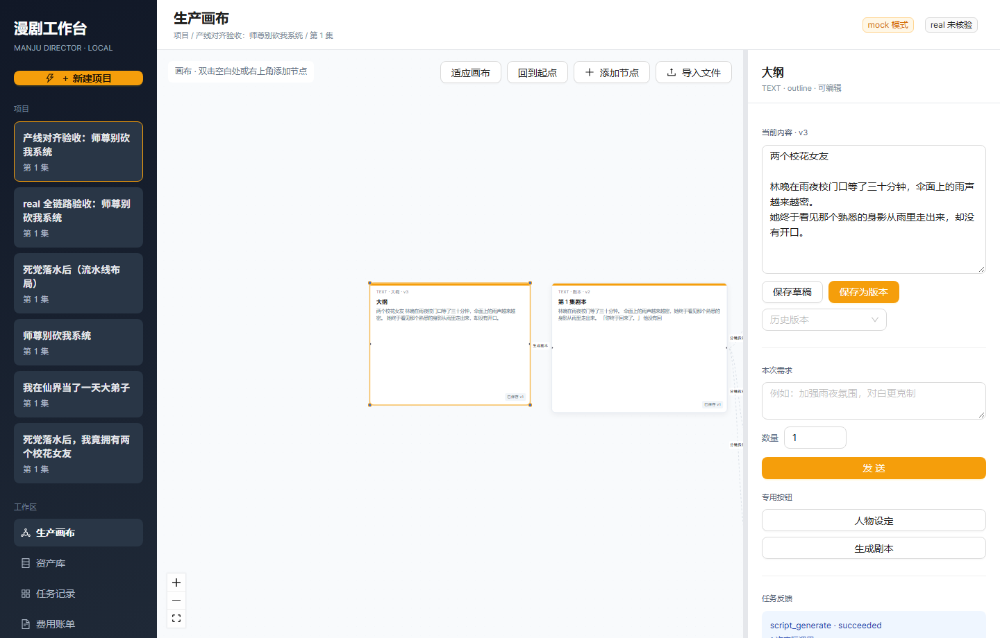
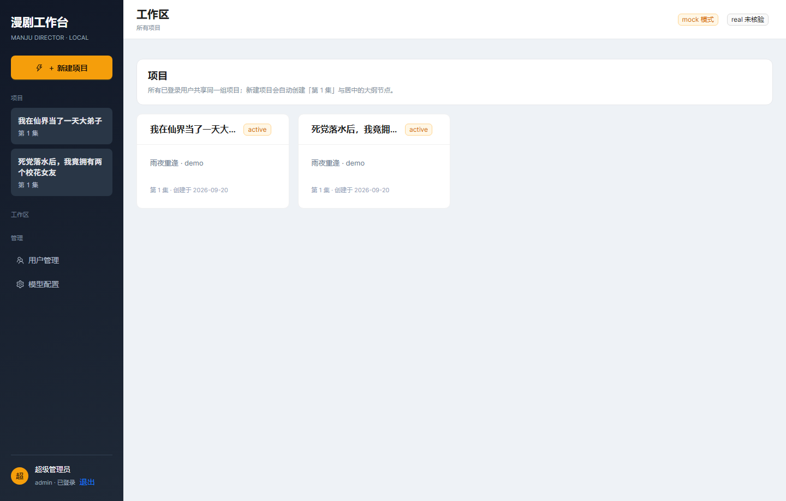
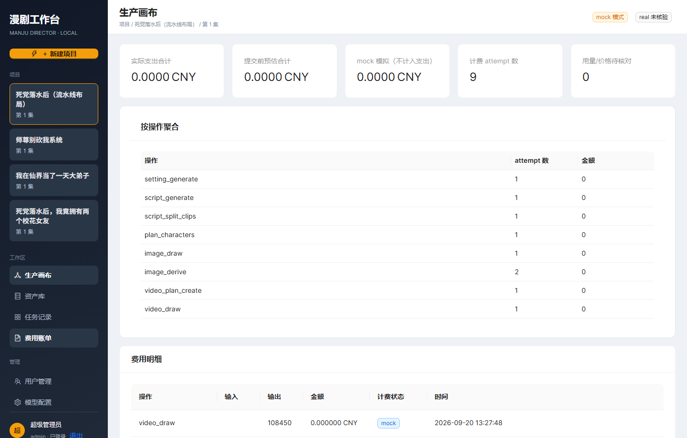
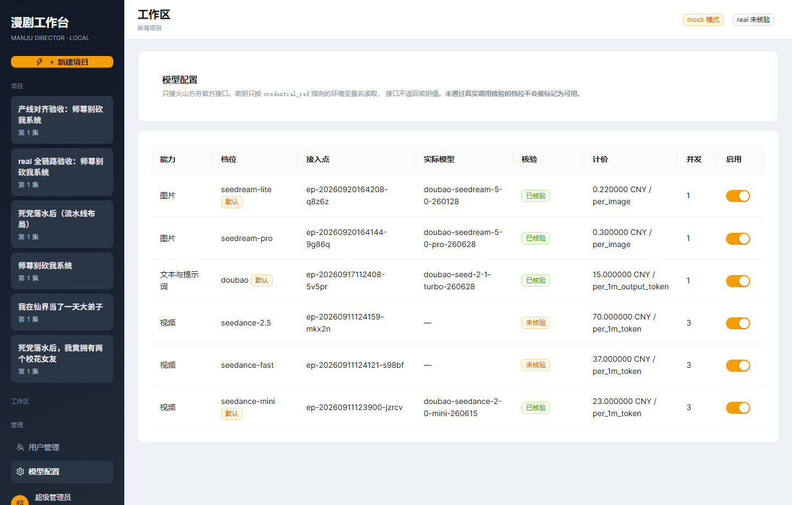

# 漫剧工作台 manju-director

把 AI 漫剧的生产流程（**大纲 → 人物设定 → 剧本 → 分镜 → 图片 → 视频**）做成非技术用户可操作的
Web 工作台：无限画布、版本追溯、资产复用、生成任务三层状态、费用记录。
只接**火山方舟官方接口**（豆包 / Seedream / Seedance），不接任何第三方中转。

> 本工程是从零实现的完整前后端，不是任何既有仓库的续写。
> 需求基线见 [`docs/baseline/PRD.md`](docs/baseline/PRD.md)，
> 外部模型合同见 [`docs/baseline/API对接文档.md`](docs/baseline/API对接文档.md)，
> 与真实产线的对齐见 [`docs/production-alignment.md`](docs/production-alignment.md)。

**先有 PRD 与 OpenAPI 契约，再写代码，最后按 PRD 逐条验收**：

| 交付物 | 位置 |
|---|---|
| 需求基线（PRD） | [`docs/baseline/PRD.md`](docs/baseline/PRD.md) |
| 手写的正式 OpenAPI 3.1 契约（设计合同，98 KB） | [`docs/openapi.yaml`](docs/openapi.yaml) |
| 服务端实际生成的 OpenAPI | [`docs/openapi.generated.json`](docs/openapi.generated.json) |
| 对照 PRD §9 的逐条验收 | [`docs/acceptance.md`](docs/acceptance.md) |
| 需求 → 实现 → 测试的追溯矩阵 | [`docs/requirements-traceability.md`](docs/requirements-traceability.md) |
| 真实模型调用核验记录 | [`docs/real-verification.md`](docs/real-verification.md) |

**环境要求、从零复现路径（门禁 G1–G8）、常用脚本**已移到
[`docs/DEVELOPMENT.md`](docs/DEVELOPMENT.md)。

---

## 界面预览

生产画布与大纲面板（左侧项目列表，中间无限画布，右侧内容版本与需求下发）：



> 右上角的 `mock 模式` / `real 未核验` 徽章是**真实状态指示**：`mock` 模式下不发任何外部请求，
> 但产物是真的（图片真用 Pillow 画、视频真用 ffmpeg 编码）；`real` 只有真实调用成功过才会写核验时间。

工作区（项目列表）：



费用账单（按模型与档位分别计价，金额统一标 `estimated`）：



模型配置（每个模型的实际核验状态）：



---

## 1. 目录结构

```text
manju-director/
├── backend/                     FastAPI + SQLModel + Alembic
│   ├── app/
│   │   ├── core/                配置、ULID/UTC、错误码、密码哈希、隐藏预设
│   │   ├── db/                  引擎、Alembic 编程式调用、种子数据
│   │   ├── models/              24 张表的 SQLModel 实体（按领域分文件）
│   │   ├── schemas/             请求/响应模型
│   │   ├── services/            领域服务（内容版本、画布、资产、生成、计费…）
│   │   ├── providers/           豆包 / Seedream / Seedance 适配器 + mock
│   │   ├── api/                 路由、依赖注入、异常处理
│   │   └── main.py              应用入口
│   ├── alembic/                 迁移
│   ├── scripts/                 环境预检、建库、导出 OpenAPI、冒烟、演示数据、Chrome 截图
│   ├── tests/                   117 个用例
│   ├── requirements.txt         依赖声明（范围，只在升级依赖时改）
│   └── requirements.lock        依赖锁定（复现验证结论用这个）
├── frontend/                    React 19 + Vite 7 + TS + antd + React Flow 12
│   └── src/{api,auth,layout,pages,canvas,components}
├── scripts/
│   └── verify_clean_env.ps1     从零复现门禁 G1–G8，一条命令跑完（等价于 DEVELOPMENT.md §3.1）
└── docs/
    ├── openapi.yaml             手写的正式 OpenAPI 3.1 契约（设计合同）
    ├── openapi.generated.json   服务端实际生成的 OpenAPI 3.1
    ├── how-to-test.md           怎么测（手工 / 自动化 / 逐条验收）
    ├── real-verification.md     真实模型调用核验记录
    ├── acceptance.md            对照 PRD §9 的逐条验收
    └── screenshots/             Chrome 截图
```

---

## 2. 关键设计说明

### 2.1 三层状态互不覆盖

| 层 | 载体 | 含义 |
|---|---|---|
| logical | `generation_submissions.logical_status` | 用户目标是否完成 |
| physical | `generation_attempts.physical_status` | 供应商调用到哪一步 |
| delivery | `delivery_records` + `attempts.delivery_status` | 本地落盘与解码核验 |

HTTP 200、拿到 URL、供应商 `succeeded` **都不等于交付完成**；媒体必须落盘、可定位、可解码。

### 2.2 幂等与"发送锁"

- 生成类写请求必须带 `Idempotency-Key`；同 key 不同请求体返回 409 `IDEMPOTENCY_CONFLICT`。
- 同一节点存在未结束提交时，服务端拒绝新提交（409 `GENERATION_IN_PROGRESS`）。
  **锁在服务端**，前端按钮只是体验。
- 用户再次点击生成属于新操作，必须换新 key。

### 2.3 版本与布局分离

- 内容表（文档 / Clip）有乐观锁 `version`；不匹配返回 409。
- 草稿与不可变历史版本分开；只有实际修改才新增版本，首次保存为 v1，切换历史版本不新增版本。
- 拖动与改尺寸只写 `canvas_node_layout`，不产生版本、不影响内容指纹。

### 2.4 隐藏 A 与可见 B

图片方案的隐藏预设 A、完整内部组装文本 `final_input_text` 只存服务端，
**任何响应、日志、来源查询都不返回**；接口只给用户可见可编辑的 B（`visibleText`）。

### 2.5 视频方案冻结输入

Clip【生成视频】会先校验「每个所需资产**恰有一个**未屏蔽、文件可用的图片结果」，
通过后冻结 Clip、参考图与槽位顺序；之后方案节点只吃这份冻结上下文，不偷偷读最新 Clip。
校验不过会**点名具体资产**并返回 422，不调用视频模型。

### 2.6 视频提示词按产线规范产出并校验

提示词结构来自用户真实产线的终剪交付物（见
[`docs/production-alignment.md`](docs/production-alignment.md)），不是自由发挥：

- 参考图逐张写「参考图一：…」，编号与冻结槽位一致，**不得省略、不得「同上」**
- `镜头N（起-止秒）：` 分镜段，编号连续，**时间加总等于片段时长**
- 环境音段 + 以「无字幕，避免生成任何文字或字幕」收尾
- 严禁「保持一致」「连续继承」与 lora/controlnet 等旧体系术语

`app/services/prompt_rules.py` 把这套规则做成 lint，问题会当场挂在方案节点上并在抽屉里列出。
**它是 lint 不是闸门**——产线的经验是「判一版提示词至少要跑 2 发」，所以不拦死用户，但绝不让你蒙着眼睛烧钱。

### 2.7 提交前校验

按官方档位规格在**调用模型之前**拦截，被拦下不产生 attempt、不产生费用：

| 项 | 规则 |
|---|---|
| 视频时长 | mini / fast 4–15s；2.5 4–30s。超范围报错并提示改档，**不静默截断** |
| 参考图 | 每片段 ≤ 9 张，超限报错并提示调整，**不自动丢图** |
| 图片尺寸 | 面积 ≥ 3,686,400 像素（1024×1024 会被官方明确拒绝） |

### 2.8 计费

计价口径存在 `model_configs.spec_json.pricing`，逻辑在 `app/services/pricing.py`，
**改单价不用改代码**。当前登记的是用户提供的官方报价：

| 模型 | 口径 |
|---|---|
| 豆包 | 输入 3、输出 15 元/百万 tokens（**两边单价不同，分开乘**） |
| seedance mini | 不含视频输入 23、含 14 元/百万 tokens |
| seedance fast | 不含视频输入 37、含 22 |
| seedance 2.5 | 480P/720P 不含 70、含 42；1080P 不含 77、含 46 |
| seedream pro | 输入图 0.02 元/张（首张免费）；输出图 ≤261 万像素 0.3、>261 万像素 0.6 元/张 |
| seedream lite | 0.22 元/张（文生图与图生图同价） |

原则：

- 视频按**输出 token**计价；本版只发参考图，按「不含视频输入」档
- seedream pro 的输出单价由**产物实际像素**决定，不看请求参数
- 金额统一标 `estimated`（按回执用量折算，未经账单确认）；
  **单价缺失或口径不认识时记 unknown/null，绝不记 0**——0 会被读成免费
- 调价后跑 `scripts/recalc_usage.py` 即可重算历史账，**不需要重跑生成**

### 2.9 mock 与 real 的边界

- `mock`：不发任何外部请求，但产物是**真的**——图片真用 Pillow 画、视频真用 ffmpeg 编码、
  首帧真提取。这样自动验收才有意义。
- `real`：只走火山方舟官方接口。没有凭证时**直接失败**（`PROVIDER_UNAVAILABLE`），
  绝不静默退回 mock。
- 只有真实调用成功过才写 `model_configs.verified_at`；`/meta` 的 `realAvailable` 只看这个字段。

---

## 3. 已知边界

- **单集 Demo**：只开放第 1 集，数据保留剧集归属；不做多集管理、跨集复制、批量扫描、打包迁移。
- **不做**：充值/余额/支付、报表、复杂权限审批、视频编辑拼接、成片合成。
- 手动创建节点需先有业务对象：文本节点来自导入或生成，分镜节点用「新建分镜（Clip）」创建。
- `seedance-fast` / `seedance-2.5` 的规格与计价**尚未真实核验**，界面会显式标注「未核验」。
- **真人写实项目过不了官方第一道拦截**（参考图检测到真人脸即 400，不扣费）。
  PRD 明确只接官方接口，因此本版没有接入中转保底通道，真人写实项目在视频阶段会走不通。
- 未接入手册里的 m（本地 ComfyUI 免费草稿层），直接走官方 s-mini，成片更快但更贵。
- **开发机端口是本地状态，不是仓库属性**：作者这台机器上 8010 / 5173 被遗留的旧项目
  dev server 占用，所以开发时用 8020 / 5180；代码与契约里的默认值仍是 8010 / 5173。
  你的机器上哪个端口被占，用 `python backend\scripts\check_env.py` 看「端口」那一项（只是 WARN）。

更完整的对齐情况与「还没做的对齐」见 [`docs/production-alignment.md`](docs/production-alignment.md)。

环境要求、从零复现路径与常用脚本见 [`docs/DEVELOPMENT.md`](docs/DEVELOPMENT.md)。
